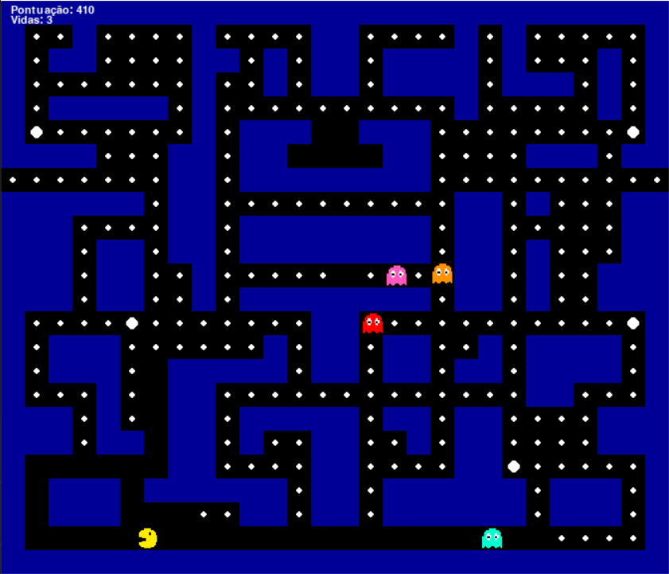

<div align="center">

# Pac-Man em Python

**Recriação do clássico arcade feita com Python e Pygame, com quatro fantasmas de personalidades diferentes.**




</div>

---

## Sumário

- [Sobre o projeto](#sobre-o-projeto)
- [Funcionalidades](#funcionalidades)
- [Como jogar](#como-jogar)
- [Como executar](#como-executar)
- [Os fantasmas](#os-fantasmas)
- [Estrutura do projeto](#estrutura-do-projeto)
- [Tecnologias e conceitos](#tecnologias-e-conceitos)
- [Integrantes](#integrantes)

---

## Sobre o projeto

**Objetivo:** desenvolver um jogo no estilo Pac-Man, em que o jogador percorre um labirinto comendo todos os pontos enquanto foge de quatro fantasmas. O projeto aplica, na prática, conceitos de programação orientada a objetos, lógica de jogos e algoritmos de busca de caminho.

O jogador vence ao comer todos os pontos do mapa e perde ao ficar sem vidas.

---

## Funcionalidades

- Movimento por tiles, com curvas facilitadas (o comando de virada fica guardado por um instante)
- Quatro fantasmas com comportamentos diferentes de perseguição
- Busca de caminho (BFS), então os fantasmas contornam as paredes em vez de andar em linha reta
- Pastilhas de poder: os fantasmas ficam assustados, azuis e mais lentos, e podem ser comidos
- Túnel lateral: sair por um lado do mapa leva ao lado oposto
- Sistema de vidas, pontuação e telas de **Game Over** e **Vitória**

### Pontuação

| Item | Pontos |
|------|-------:|
| Ponto comum | 10 |
| Pastilha de poder | 50 |
| Fantasma assustado | 200, 400, 800 e 1600 (em sequência) |

---

## Como jogar

| Tecla | Ação |
|:-----:|------|
| Seta para cima | Mover para cima |
| Seta para baixo | Mover para baixo |
| Seta para a esquerda | Mover para a esquerda |
| Seta para a direita | Mover para a direita |

Coma todos os pontos, pegue as pastilhas de poder para virar o jogo e evite os fantasmas. Você começa com **3 vidas**.

---

## Como executar

**Pré-requisitos:** [Python 3.10+](https://www.python.org/downloads/) instalado.

```bash
# 1. Clone o repositório
git clone https://github.com/usuario/repositorio.git
cd repositorio

# 2. (Opcional) crie e ative um ambiente virtual
python -m venv venv
venv\Scripts\activate        

# 3. Instale a dependência
pip install pygame

# 4. Execute o jogo
python main.py
```

> Rode o comando a partir da pasta onde está o `main.py`, porque as imagens são carregadas por caminho relativo (`assets/...`).

---

## Os fantasmas

Todos herdam da mesma classe `Fantasma` e mudam apenas **o alvo** que perseguem.

| Fantasma | Cor | Comportamento |
|----------|:---:|---------------|
| **Blinky** | Vermelho | Persegue o Pac-Man diretamente |
| **Pinky** | Rosa | Embosca, mirando 4 tiles à frente do Pac-Man |
| **Inky** | Azul | Tenta cercar o pacman, usando a posição do Blinky |
| **Clyde** | Laranja | Persegue de longe, mas foge para o canto quando chega perto |

---

## Estrutura do projeto

<details>
<summary>Clique para expandir</summary>

```
pacman/
├── main.py                  # Loop principal do jogo
├── mapas/
│   └── mapa1.py             # Classe Mapa: layout, paredes, pontos e túnel
├── personagens/
│   ├── pacman.py            # Classe Pacman: movimento, animação e pontuação
│   └── fantasma.py          # Classe Fantasma e as subclasses Blinky, Pinky, Inky e Clyde
└── assets/
    ├── pacman/              # Sprites do Pac-Man (direita, esquerda, cima, baixo)
    └── fantasmas/           # Sprites dos fantasmas
```

</details>

---

## Tecnologias e conceitos

- **Python** e **Pygame**
- **Programação orientada a objetos**: herança (`Blinky`, `Pinky`, `Inky` e `Clyde` herdam de `Fantasma`)
- **Busca em largura (BFS)** para calcular o caminho dos fantasmas
- **Movimento baseado em grade (tiles)** com decisão de direção nos cruzamentos
- **Máquina de estados** simples para o modo normal e o modo assustado

---

## Integrantes

| Nome |
|------|
| Mateus Pedroso de Camargo |
| Sthefany Pereira Guedes Prestes |

---